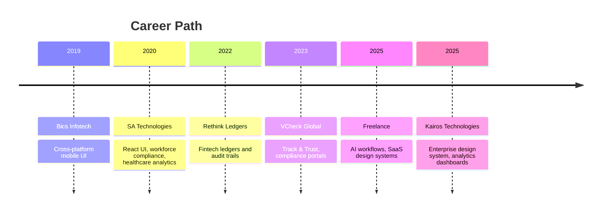
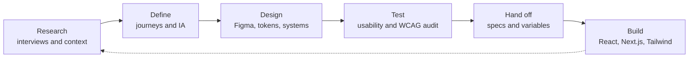

# Hi 👋, I'm Sopan Ganage

### Senior Product Designer · UI/UX Designer · UI Developer

**Enterprise SaaS · Financial & Compliance Platforms · Design Systems · Accessibility (WCAG 2.2)**

  
  
  
  

📍 Pune, Maharashtra, India &nbsp;·&nbsp; 🟢 Open to Pune & Remote opportunities

---

## 👨‍💻 About Me

Senior Product Designer with **7+ years** of experience designing user-centered digital products across **enterprise SaaS, financial technology, and large-scale digital platforms**. I cover the full design process: research, journey mapping, information architecture, usability testing, UX writing and high-fidelity Figma prototyping. I also build the UI myself with **React, Next.js, TypeScript and Tailwind CSS**, so my designs hand off cleanly to engineering.

- 🏦 Financial ledger workflows, transaction audit trails, and compliance-driven interfaces
- 🧱 Multi-brand enterprise design systems with Figma variables and component tokenization
- ♿ WCAG 2.2 AA/AAA accessibility audits and inclusive design
- 🤖 Human-AI interaction design (transparency, control, fallback states) using AI-assisted tools
- 🤝 Agile/Scrum collaboration and executive design presentations

---

## 📊 Impact at a Glance

| 👥 Scale | 🔬 Research | ⚡ Handoff speed | 📉 Error reduction | 📈 Engagement |
|:---:|:---:|:---:|:---:|:---:|
| **10,000+** daily active users on dashboards I helped design | **40+** user interviews & usability tests | **60%** faster developer handoff | **35%** fewer user errors | **45%** higher enterprise engagement |

*(Figures from my professional experience; see the experience section for context.)*

---

## 🛠️ Technical Skills

### Frontend & UI Development

  
  
  
  
  
  
  
  

**What I build with it:** data tables with pagination/filtering, role-based dashboard navigation, responsive layouts, client-side form validation, REST API data fetching, and state management with React Hooks and Context API. Performance work includes component memoization and front-end code optimization.

### Product Design & Prototyping

  
  
  
  

| Area | Skills |
|---|---|
| **Product Design & UX Strategy** | End-to-end product ownership, enterprise SaaS, financial workflows & compliance, user journey mapping, information architecture, personas, usability heuristics, content hierarchy |
| **Research & Testing** | User interviews, contextual research, usability testing, heuristic evaluations, A/B-test and session-analysis informed design, competitive analysis |
| **UI Design & Prototyping** | Responsive & mobile-first design (iOS, Android, web), high-fidelity Figma prototyping, micro-interactions, UX writing & microcopy |
| **Design Systems** | Multi-brand systems, Figma variables & component tokenization, governance & component lifecycles, design-to-code alignment |
| **Accessibility** | WCAG 2.2 AA/AAA, color contrast, focus states, aria-token definitions, accessibility audits, inclusive design |
| **Collaboration** | Agile/Scrum, design critiques, executive presentations, requirement translation, data-informed decisions |

### AI-Assisted Design & Development Tooling

  
  
  

### Version Control & Deployment

  
  
  

### 🗄️ Backend, Databases & Cloud (personal full-stack work)

My professional work is UI-focused, so I don't claim backend ownership in my enterprise roles. In my personal **Campus Assessment Portal** project I worked with:

  
  
  
  

Areas considered: authentication, sessions, data protection and REST API integration.

---

## 💼 Professional Experience & Organization Contributions

> Enterprise work is delivered inside company organizations and private repositories. Client names, code and screens are confidential, so I describe the **type of product, workflow and my contribution** rather than internal details.

### Sr. UI/UX Designer, Kairos Technologies
**Client assignment: confidential enterprise client (internal application) · Jul 2025 – Present**

**Product type:** business dashboards and enterprise analytics platforms, 10,000+ daily active users.

- Architected responsive, mobile-first journeys and complex enterprise workflows, from wireframes and journey maps to high-fidelity Figma prototypes
- Built and governed a **multi-brand, cross-platform design system** with component tokenization, semantic variables and auto-layout
- Set up multi-team governance and component lifecycle documentation
- Led accessibility audits and embedded **WCAG 2.2 AA/AAA** contrast, focus states and aria-token definitions into core components
- Ran **40+ user interviews and usability tests** to turn complex predictive data into reusable UI patterns
- **Impact:** 60% faster Agile handoff · 35% lower error rates · 45% higher engagement

### UI/UX Designer, Freelance Projects (Remote) · Jan 2025 – Jul 2025

**Product type:** global SaaS products (5+ clients), human-AI interactive workflows.

- Designed AI workflows covering transparency, control and fallback states using Claude Code, Cursor and Figma AI
- Delivered research, journey maps, personas, wireframes, UX copy and usability testing
- Published scalable Figma design systems and component libraries to WCAG 2.1/2.2 AA/AAA
- Evaluated checkout funnels and onboarding flows through heuristic reviews and competitive analysis
- **Impact:** 40% faster design iteration · 30% faster client engineering delivery

### Sr. UI/UX Designer, VCheck Global · Apr 2023 – Dec 2024 · Pune

**Product type:** Track & Trust Portal (background verification), compliance workflows, multi-role business reporting portals.

- Led end-to-end UX for the flagship portal using interviews, stakeholder workshops, heuristic evaluations, IA mapping and usability testing
- Delivered wireframes, interactive prototypes, UX copy guidelines and accessible component libraries
- Implemented dashboard components and layouts in **React.js, Next.js and Tailwind CSS**
- **Impact:** 20% higher customer retention · 25% better usability · 32% lower bounce rate · 45% higher engagement

### UI/UX Designer, Rethink Ledgers · Jul 2022 – Apr 2023 · Pune

**Product type:** fintech: double-entry ledger, transaction audit trails, financial reporting dashboards (web, iOS, Android).

- Redesigned ledger input flows and audit trails to meet banking and regulatory requirements
- Optimized acquisition funnels and onboarding using A/B testing, session analysis and user feedback
- Ran usability tests, heuristic evaluations and design sprints
- **Impact:** 35% better task completion · 20% higher lead-to-sale conversion

### UI/UX Designer, SA Technologies · Feb 2020 – Jul 2022 · Pune

**Product type:** WorkMarshal (enterprise workforce compliance platform) and healthcare analytics web apps.

- Coded UI in **React.js, HTML5, SCSS and TypeScript**: data tables with pagination/filtering, role-based dashboard navigation
- Managed state with React Hooks and Context API; added client-side form validation and REST API data fetching
- **Impact:** 45% better Core Web Vitals · 40% faster page loads

### UI/UX Designer, Bics Infotech · Feb 2019 – Feb 2020 · Pune

**Product type:** cross-platform mobile apps (iOS & Android).

- Simplified complex navigation through information architecture; ran rapid usability tests and heuristic evaluations
- **Impact:** 10% higher retention on the flagship Android app · 35% shorter implementation time

### 🔒 Private Repository & Organization Activity

My organization work typically includes design-to-code implementation of UI components, design system maintenance, pull requests and code reviews, and issue tracking within company-managed repositories. Much of this isn't visible on my public profile, and contribution depth varies by project permissions.

---

## 📈 Career Timeline

---

## 🔄 How I Work

---

## 🚀 Selected Projects

| Project | Type | Focus |
|---|---|---|
| **Track & Trust: Secure Asset / Verification Portal** | Enterprise UX (VCheck + case study) | Role-based dashboards, compliance, accessibility |
| **Cab Driver Wallet App** | Mobile fintech | Earnings, commissions, payouts, weekly insights |
| **UrbanRide / RideEase** | Ride-booking MVP | Booking journeys, responsive UI |
| **QuillAI Network** | Web3 cybersecurity concept | Product experience for security workflows |
| **Home.LLC Website Redesign** | Website UX | Content hierarchy, accessibility, visual design |
| **Campus Assessment Portal** | Web app (React, Node.js, Supabase, Vercel, PostgreSQL) | Registration, controlled exam access, auth and data protection |
| **AI-Powered Product Experiences** | AI UX | Transparent, controllable human-AI workflows |

👉 **[Full case studies](https://sopan-ganage.vercel.app/)** · **[Behance](https://www.behance.net/ganagesm)** · **[Presentation deck](https://docs.google.com/presentation/d/1tsrmWWBJ9Pm5EJjISxW_MN_afPJJuP4f/edit)** · **[Public repositories](https://github.com/ganagesm?tab=repositories)**

---

## 🧭 Complete Work Map: Personal, Open & Organization

Most of my day-to-day commits, pull requests and reviews happen in **private, company-owned repositories**. GitHub counts them in my contribution totals, but their code, names and details can't be shown publicly. This map shows where my work lives.

### 🏢 Organization / Client Work (private, confidential)

| Period | Organization | Product type | What I contributed | Tech & tools |
|---|---|---|---|---|
| Jul 2025 – Present | Kairos Technologies (confidential client) | Enterprise analytics & business dashboards, 10,000+ daily active users | Multi-brand design system, WCAG 2.2 audits, journeys and prototypes, design tokens and variables for handoff | Figma, design tokens, accessibility |
| Apr 2023 – Dec 2024 | VCheck Global | Track & Trust Portal: background verification, compliance, multi-role reporting | End-to-end UX, research, component libraries, dashboard UI implementation | Figma, React.js, Next.js, Tailwind CSS |
| Jul 2022 – Apr 2023 | Rethink Ledgers | Fintech: double-entry ledger, audit trails, financial dashboards (web, iOS, Android) | Ledger input redesign, onboarding funnels, usability tests, design sprints | Figma, A/B testing, session analysis |
| Feb 2020 – Jul 2022 | SA Technologies | WorkMarshal workforce compliance platform, healthcare analytics web apps | Built UI components: data tables, role-based navigation, form validation, API data fetching | React.js, TypeScript, SCSS, HTML5, Hooks, Context API |
| Feb 2019 – Feb 2020 | Bics Infotech | Cross-platform mobile apps (iOS & Android) | Information architecture, wireframes, rapid usability tests | Wireframing, prototyping |
| Jan 2025 – Jul 2025 | Freelance (5+ global SaaS clients) | SaaS products, human-AI workflows | Design systems, UX research, AI-assisted prototyping | Figma, Claude Code, Cursor, Figma AI |

### 👤 Personal & Concept Projects

| Project | Type | What it shows |
|---|---|---|
| Campus Assessment Portal | Web application | Registration, controlled exam access, authentication/session planning (React, Node.js, Supabase, PostgreSQL, Vercel) |
| Cab Driver Wallet App | Mobile fintech concept | Earnings, commissions, payouts, weekly insights |
| UrbanRide / RideEase | Ride-booking MVP | Booking journeys, responsive UI |
| QuillAI Network | Web3 cybersecurity concept | Product experience for security workflows |
| Home.LLC Redesign | Website UX | Content hierarchy, accessibility, visual design |

### 🌍 Where to See More

| What you want to see | Where |
|---|---|
| Visual case studies (Track & Trust, fintech, AI UX) | [Case studies](https://sopan-ganage.vercel.app/) · [Behance](https://www.behance.net/ganagesm) · [Presentation deck](https://docs.google.com/presentation/d/1tsrmWWBJ9Pm5EJjISxW_MN_afPJJuP4f/edit) |
| Public code | [Public repositories](https://github.com/ganagesm?tab=repositories) |
| Public PRs and issues | [Pull requests](https://github.com/ganagesm?tab=pulls) · [Issues](https://github.com/ganagesm?tab=issues) |
| Private / organization work | Described above; details available in conversation or interview, within confidentiality limits |

<!-- TODO: add links to any public repos you want to highlight, e.g.
- [repo-name](https://github.com/ganagesm/repo-name): one-line description and tech -->

---

## 🎓 Education & Certifications

- 🎓 **B.Sc. Computer Science**, Dr Babasaheb Ambedkar Marathwada University (2014–2019)
- 📜 Design Thinking: The Ultimate Guide, Interaction Design Foundation (2024)
- 📜 Human-Computer Interaction: The Foundations of UX Design, Interaction Design Foundation (2024)
- 📜 Adobe XD for Designers, LinkedIn Learning (2021)
- 📜 WCAG 2.2 Web Accessibility Compliance & Inclusive Design (self-study)
- 🗣️ English (fluent) · Marathi (native) · Hindi (fluent)

---

## 📊 GitHub Statistics

### Profile Overview and Top Languages

### Contribution Streak

### Activity Graph

### Contribution Calendar

### Self-hosted Metrics (generated by GitHub Actions)

> **Note:** The cards above depend on third-party services that occasionally rate-limit or go down; the self-hosted metrics image is generated in this repository and doesn't have that problem. Language statistics reflect public code only and don't measure design skills, and private organization work appears only if private contributions are enabled in profile settings.

---

## 🤝 Let's Collaborate

I'm open to **Senior Product Designer, Senior UX/UI Designer, UI Developer, and AI Product Design** roles, and to collaborations on design systems, enterprise UX and MVPs.

| | |
|---|---|
| 🌐 Case studies | https://sopan-ganage.vercel.app/ |
| 🎨 Behance | https://www.behance.net/ganagesm |
| 💼 LinkedIn | https://www.linkedin.com/in/ganagesm/ |
| 🐙 GitHub | https://github.com/ganagesm |
| 📧 Email | Gangesm1@gmail.com |

*Let's design, build and improve digital products together.* ⭐

